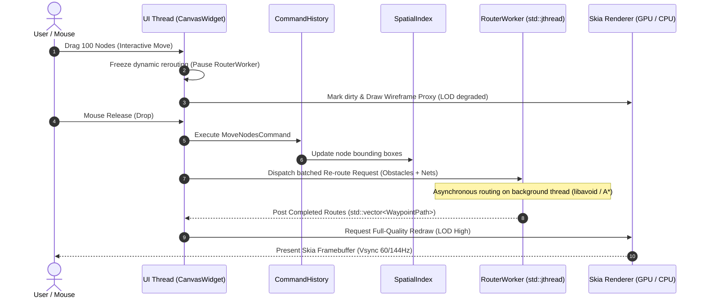
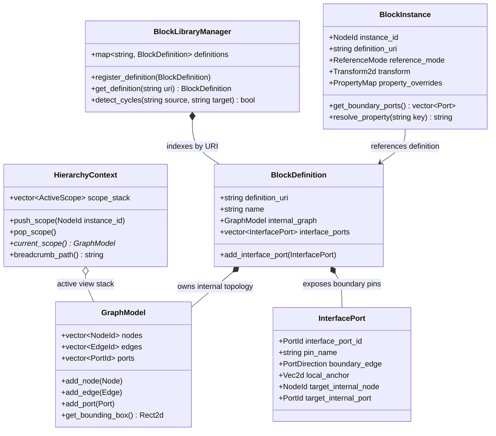
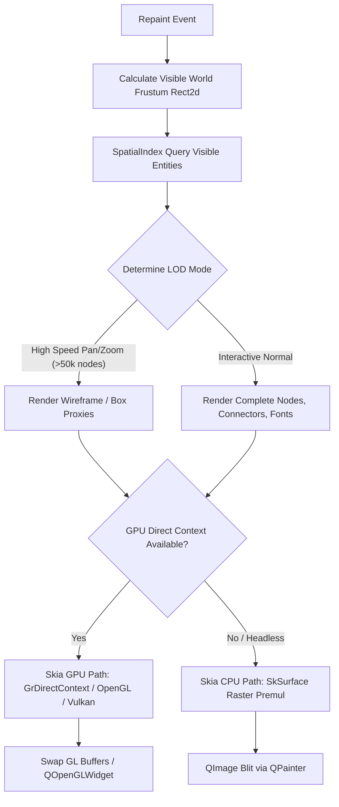
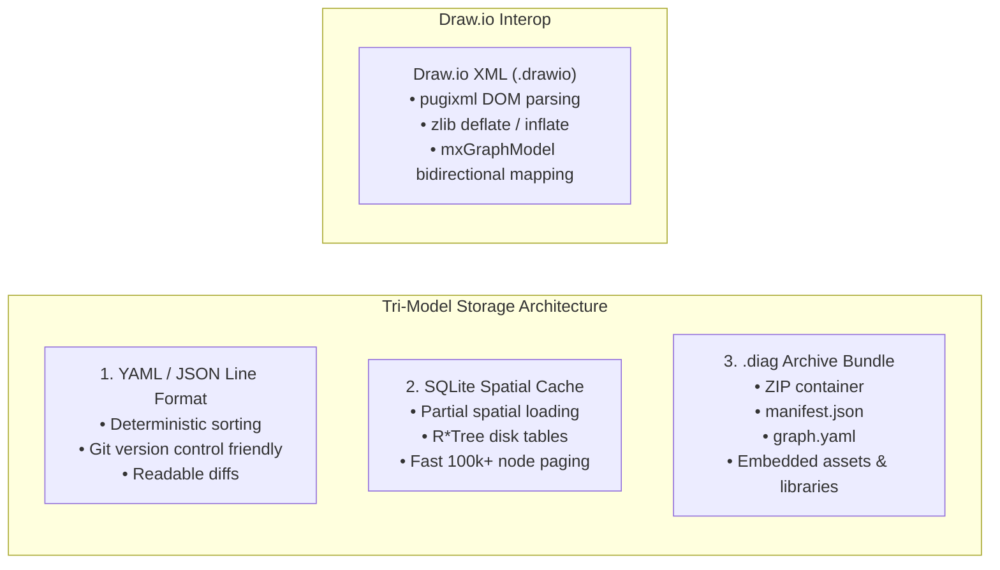
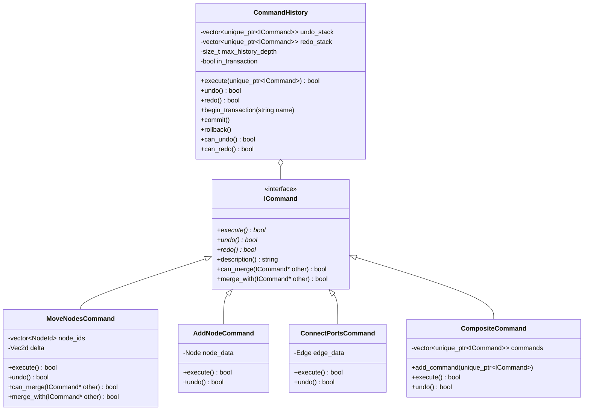

# VECTOR: Viewport Engine for Concurrent Topology & Obstacle-avoiding Routing
## Core Architecture Specification & System Design Manual

**Project Name:** VECTOR (`libvector`, `vector-gui`, `vector-cli`)  
**License:** GNU General Public License v3 (GPLv3)  
**Language Standard:** Modern ISO C++20 (`std::jthread`, concepts, ranges, designated initializers)  
**Target Platform:** Linux (X11 & Wayland), POSIX-compliant  
**Precision Standard:** Double-precision IEEE 754 (`double`) for world-space canvas geometry  

---

## 1. Executive Summary & Design Philosophy

VECTOR is an open-source, high-performance 2D diagramming and schematic engine engineered to scale smoothly to massive networks (10,000 to 100,000+ nodes and edges). It provides native support for hierarchical blocks, sub-sheet instantiations, asynchronous obstacle-avoiding routing, dual-backend hardware/software rendering, and transactional editing.

### Key Tenets
1. **Zero-Coupling Core Domain**: The core domain layer (`vector::core`) has zero dependencies outside the C++20 standard library. Core geometry, topology, spatial indexing, and transactional history are decoupled from Qt, Skia, and OS-specific windowing systems.
2. **Double-Precision World Space**: All canvas coordinates are stored as 64-bit IEEE 754 `double` values to ensure sub-millimeter precision across extreme zoom ranges ($10^{-5}$ to $10^{5}$) without spatial jitter or floating-point rounding degradation.
3. **Viewport Isolation & Spatial Culling**: Complex sub-diagrams and child graphs are encapsulated within opaque bounding polygons in parent viewports. Only visible elements within the active frustum are processed and rasterized.
4. **Asynchronous Non-Blocking Workers**: CPU-intensive algorithms (dynamic obstacle avoidance via `libavoid`, graph auto-layout via OGDF, spatial SQLite caching) run on detached background worker threads (`std::jthread`) to guarantee an uninterrupted 60/144 FPS UI experience.

---

## 2. High-Level System Architecture

```mermaid
graph TD
    subgraph UI_Layer ["Presentation & Viewport Layer"]
        QW[CanvasWidget (QOpenGLWidget / QWidget)]
        CR[CanvasRenderer (Skia Dual GPU / CPU Engine)]
        GM[GridManager (Cartesian Grid & Multi-Constraint Snap)]
        BC[HierarchyBreadcrumb / Navigation Tabs]
    end

    subgraph Core_Layer ["Core Domain Layer (Zero-Dependency C++20)"]
        GMdl[GraphModel (Nodes, Ports, Connectors)]
        HBlock[HierarchicalBlock (Definitions, Instances, InterfacePorts)]
        SIdx[SpatialIndex (R-Tree / Flat BVH Frustum Culling)]
        CmdHist[CommandHistory (Transactional Undo / Redo)]
        Geom[Geometry (Vec2d, Rect2d, Transform2d, Polygon2d)]
    end

    subgraph Worker_Layer ["Concurrent Worker Layer (std::jthread)"]
        RW[RouterWorker (libavoid / Orthogonal A* Router)]
        LW[LayoutWorker (OGDF Sugiyama / Orthogonal TSM)]
    end

    subgraph IO_Layer ["Storage & Interop Layer (Tri-Model)"]
        YAML[YAML / JSON Line-Oriented Serializer]
        SQL[SQLite Spatial Cache Engine]
        ZIP[Archive Container .diag Zip Engine]
        DIO[DrawioParser (pugixml + zlib Import / Export)]
    end

    QW --> CR
    QW --> GM
    QW --> BC
    QW --> Core_Layer
    Core_Layer --> RW
    Core_Layer --> LW
    Core_Layer --> IO_Layer
```

---

## 3. Threading Topology & Concurrency Model

VECTOR uses a multi-threaded cooperative architecture to keep the UI thread responsive during multi-node edits and routing recomputations.



### Thread Allocations
- **Main / GUI Thread (`vector-gui`)**:
  - Handles Qt event loop, Wayland/X11 window messages, input events (mouse, keyboard, touch gestures).
  - Maintains `CommandHistory` and dispatches UI repaint commands.
- **Render Worker / GPU Context**:
  - Encapsulates `GrDirectContext` and OpenGL/Vulkan rendering calls.
  - In software fallback mode, multi-threaded SIMD software rasterization writes to a `QImage` memory buffer blitted on `paintEvent`.
- **Router Worker (`RouterWorker`, `std::jthread`)**:
  - Dedicated background thread executing obstacle avoidance graph queries.
  - Communicates via a thread-safe synchronized request/response queue with atomic cancellation flags (`std::atomic<bool>`).
  - Supports "freeze-during-drag" optimization: routing requests are deferred while the user is actively translating multi-node selections, and dispatched in a single batch on drag termination.
- **Layout Worker (`LayoutWorker`, `std::jthread`)**:
  - Runs compute-heavy global layouts (OGDF Sugiyama hierarchical ranking, planar orthogonal TSM, force-directed Fruchterman-Reingold).

---

## 4. Hierarchical Block & Library Architecture

VECTOR treats hierarchical diagrams as first-class citizens. Diagrams are composed of reusable definitions and lightweight instances with prototype inheritance.



### 4.1 Block Definitions vs. Block Instances
- **`BlockDefinition`**:
  - An immutable or upstream-managed sub-graph template identified by URI (e.g. `vector://stdlib/alu_32bit.diag` or `file:///projects/subsys/rf_front.yaml`).
  - Owns its private `GraphModel` in local coordinate space (with origin `(0, 0)`).
  - Exposes an explicit set of boundary `InterfacePort` definitions that bind external pins to specific internal nodes and ports.
- **`BlockInstance`**:
  - An active node in a parent `GraphModel` referencing a `BlockDefinition`.
  - Holds an affine transformation matrix (`Transform2d`: position, rotation, scale) mapping definition local space to parent world space.
  - Dynamically calculates world-space boundary port coordinates for top-level net attachments.

### 4.2 Referencing & Mutability Models
- **Linked by Reference (`ReferenceMode::Linked`)**:
  - The instance points to the library URI. When the upstream definition is modified, all linked instances automatically reflect the internal changes on reload.
- **Embedded / Forked (`ReferenceMode::Embedded`)**:
  - The instance maintains a disconnected, deep-copied clone of the definition's graph model. Upstream changes do not alter this instance.
- **Prototype Inheritance**:
  - Instance-level property overrides (e.g. customized labels, parameter values, component coloring) take precedence over definition defaults:
    $$\text{Property}(key) = \begin{cases} \text{Override}(key) & \text{if } key \in \text{InstanceOverrides} \\ \text{Definition}(key) & \text{otherwise} \end{cases}$$

### 4.3 Viewport Isolation & Scoping
- **Bounding Box Aggregation**:
  - In the parent canvas, a `BlockInstance` is treated as an opaque rectangular or polygonal obstacle for spatial indexing and connector routing. The thousands of internal nodes within the block do not pollute parent R-Tree queries or libavoid routing passes.
- **Push / Pop Navigation**:
  - The `HierarchyContext` maintains a breadcrumb stack (`Top / Subsystem / Leaf`). Users can double-click a block instance to push into its scope, editing internal nodes in isolation, and pop back up to top-level nets.

---

## 5. Rendering Subsystem & Viewport Engine



### Dual-Backend Pipeline
- **Primary GPU Backend**:
  - Integrates with Qt's `QOpenGLWidget` (or Vulkan surface) through Skia's `GrDirectContext`.
  - Render target binds to default framebuffer object (FBO).
  - Skia utilizes hardware shaders for anti-aliased path stroking, drop shadows, and linear/radial gradients.
- **Software Raster Fallback**:
  - Creates an `SkSurface::MakeRasterN32Premul` wrapping an allocated pixel buffer.
  - Enables flawless headless rendering in CLI batch pipelines (`vector-cli`) and resilient execution on Linux systems lacking OpenGL/Vulkan acceleration.
  - Blitted onto the viewport via `QPainter::drawImage`.

### Level-of-Detail (LOD) Policies
1. **`LOD::High` (Scale $\ge 0.5$, Idle/Slow Interaction)**:
   - Full subpixel text rendering (FreeType/HarfBuzz).
   - Render all port pins, badges, line decorations, dropshadows, and connector bridges.
2. **`LOD::Medium` (Scale $0.1 \le s < 0.5$)**:
   - Suppress minor text labels and pin badges.
   - Draw simplified bounding boxes and solid connector lines.
3. **`LOD::Proxy` (Scale $< 0.1$ or high-velocity camera movement with $>50,000$ nodes)**:
   - Render instances and nodes as solid colored proxy rectangles.
   - Bypass connector spline evaluation; draw straight Manhattan or direct bounding-box center lines.

---

## 6. Canvas Grid, Snapping & Connectors

### 6.1 Cartesian Grid Engine
- **Hierarchical Grid Coordinates**:
  - Primary spacing: $S_{major}$ (default $20.0$ world units).
  - Minor subdivisions: $N_{sub}$ (default $4$ steps per major grid unit, step size $5.0$).
- **Dynamic Scale Transitions**:
  - The grid renderer dynamically fades minor grid lines as the zoom level decreases to prevent high-frequency visual moiré patterns.

### 6.2 Snapping Matrix & Multi-Constraint Resolver
The `SnapResolver` processes cursor positions against active snap flags:
- `SnapToGrid`: Snaps coordinates to closest major/minor grid line.
- `SnapToShapeBounds`: Snaps to node bounding box edges, corners, and midpoint centers.
- `SnapToShapeCenter`: Snaps to the geometric centroid of shapes.
- `SnapToInterfacePort`: Snaps directly to port connection pins within snap tolerance radius (default $8.0$ world units).
- `SnapToConnectorOrthogonal`: Aligns moving connector waypoints along horizontal or vertical axes with preceding waypoints.

### 6.3 Dynamic Obstacle Avoidance Routing
- **Obstacle Representation**: Each node and block instance registers an expanded obstacle bounding box ($\text{Rect} + \text{Padding}$).
- **`libavoid` Integration**:
  - VECTOR delegates connector routing graphs to `libavoid` (from the Adaptagrams project), specifying port direction vectors (e.g. North, East, South, West).
  - `libavoid` constructs a visibility graph around rectangular and polygonal obstacles, generating optimal orthogonal paths with minimal crossings and corners.
- **Reference Router Fallback**:
  - A zero-dependency orthogonal A* search router operates over a dynamic spatial tile grid when external routing libraries are unlinked.

---

## 7. Spatial Indexing & Auto-Layout

### 7.1 Spatial Index (`ISpatialIndex`)
- **Zero-Dependency Flat BVH / Linear R-Tree**:
  - Built-in C++20 spatial index supporting bounding box insertion, deletion, fast bounding-box queries, and nearest-neighbor hit testing.
- **Boost.Geometry Adapter**:
  - When Boost is enabled (`VECTOR_ENABLE_BOOST`), an adapter binds to `boost::geometry::index::rtree<Item, boost::geometry::index::rstar<16>>`.
- **Query Types**:
  - `query_frustum(Rect2d visibleFrustum)`: Rapidly filters 100,000 nodes down to the visible set in $\mathcal{O}(\log N + K)$ time.
  - `query_point(Vec2d point)`: Performs precise top-down z-ordered hit testing.

### 7.2 Graph Auto-Layout Abstraction
- Abstraction layer supporting the **Open Graph Drawing Framework (OGDF)**:
  - **Sugiyama Hierarchical Layout**: For flowcharts, dependency trees, and digital logic circuits.
  - **Orthogonal TSM Layout (Topology-Shape-Metrics)**: For orthogonal schematic wiring with minimized edge crossings.
  - **Force-Directed (Fruchterman-Reingold / FM3)**: For large cluster and organic network visualization.

---

## 8. Tri-Model Storage Architecture



1. **YAML / JSON Serializer**:
   - Formatted deterministically (keys sorted alphabetically, floating-point coordinates printed with consistent precision) to guarantee clean, mergeable Git diffs.
2. **SQLite Spatial Cache**:
   - Uses SQLite with virtual spatial tables to index nodes and edges by spatial coordinates, allowing massive 100,000+ node diagrams to be paged into memory on-demand based on camera location.
3. **Archive Container (`.diag`)**:
   - A standard ZIP container housing:
     - `manifest.json`: Document metadata, schema version, UUID.
     - `root.yaml`: Top-level graph model.
     - `libraries/`: Embedded block definitions.
     - `assets/`: Embedded raster/vector icons and textures.
4. **Draw.io Interoperability (`DrawioParser`)**:
   - Bidirectional importer and exporter for `.drawio` XML files (`mxGraphModel`).
   - Supports both raw XML and base64-encoded, deflate-compressed `<diagram>` streams via `pugixml` and `zlib`.

---

## 9. Transactional Undo/Redo Engine

The command subsystem is implemented strictly within the zero-dependency C++20 domain layer:



- **Command Coalescing (`merge_with`)**: When a user drags a node across 200 mouse-move events, successive `MoveNodesCommand` instances merge into a single atomic displacement command.
- **Transactional Rollback**: Commands grouped in a transaction block can be committed atomically or rolled back completely if any sub-operation fails.
- **Scope Independence**: Operates transparently on top-level graphs or nested hierarchical child block graphs.

---

## 10. Summary

VECTOR delivers a clean, modern C++20 architecture designed for high scalability, responsive interaction, and modularity. By separating the zero-dependency core domain from rendering, windowing, and routing backends, VECTOR establishes a durable foundation for enterprise-grade diagramming on modern Linux workstations.
